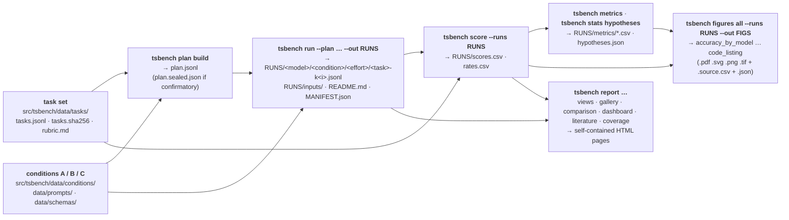

# ts-mcp-bench

Benchmark of language models on Tanabe-Sugano ligand-field tasks under three tool conditions: no tools, a code
interpreter, and the TanabeSugano MCP server.

This repository holds the TS-MCP benchmark (`tsbench`): Claude models (and, exploratory, open models through a gateway)
solve Tanabe–Sugano tasks — fit Dq, B and C to an absorption spectrum, read a term diagram, find a spin crossover —
under three conditions:

| Condition | The model gets | What it measures |
|---|---|---|
| **A** | no tools | what the model knows by itself |
| **B** | Bash in a sandbox with a fixed Python stack (numpy, scipy, sympy, matplotlib; no `tanabesugano`) | what it computes with a general code interpreter |
| **C** | the `tanabesugano` MCP server, nothing else | what it does with the domain server |

The confirmatory tasks are published as a hash only (`src/tsbench/data/tasks/tasks.sha256`, line `confirmatory`).

## The pipeline in one picture

Every box names the command and the file or folder it reads or writes.



What each step guarantees:
- **task set** — generated deterministically (`tsbench tasks generate`), verified by hash (`tsbench tasks verify`).
- **plan** — every run that will be made, frozen with its prompt, model, condition, effort, repetition and the pinned
  environment; its `plan_id` is the hash of the run records.
- **run** — one `claude -p` call per planned run; the transcript is kept verbatim. The run folder also stores the
  **inputs** that made it: `inputs/commands.sh` (the exact commands, key values never written), `inputs/plan.jsonl`,
  `inputs/hashes.json` (task set, prompts, schemas, sandbox settings, B stack, versions) and a `README.md`.
- **score** — the answer of every transcript against the task's reference and tolerance (`scores.csv`), per task
  (`rates.csv`).
- **stats, figures, report** — read the score tables only; they never call a model.

## Quick start (no key, no cost)

```bash
uv sync --extra test
uv run tsbench tasks verify                      # counts and hashes of the task set
bash tools/ci/e2e_dry.sh                         # the whole pipeline with the fake claude (pilot tasks) → build/ci/e2e/
tools/render_mock.sh                             # a demo run set made with the fake claude, every figure and page → mock-site/
tools/functional_test.sh --fake                  # the functional test, fake claude → functional-test/SUMMARY.html
uv run tsbench --help                            # every command
```

A real run needs Claude Code, an API key in the environment (`TSMCP_ANTHROPIC_API_KEY`, else `ANTHROPIC_API_KEY`) and, for condition B, the
fixed stack (`tsbench env b-stack`) and a passing sandbox probe (`tsbench env sandbox --probe`). `tsbench doctor` checks
all of it, makes no model call unless you add `--probe --out DIR`, installs nothing and never prints a key value.

## Where to read more

| Page | For |
|---|---|
| `docs/pipeline.md` | the stages, their files, the hash chain and the CI pipeline |
| `docs/methods.md` | the task record, answer format, runs, run plan and metric definitions |
| `docs/functional-test.md` | the functional test of this repository and how to read its report |
| `src/tsbench/data/tasks/rubric.md` | the task classes, oracles and tolerances |
| `CONTRIBUTING.md` | setup, checks and conventions for changes |

## Licence and citation

Code MIT (`LICENSE`); published data and results CC-BY-4.0. Citation metadata: `CITATION.cff`.

## Availability

The benchmark, its task set, run plans and results follow the FAIR principles: they are findable, accessible,
interoperable and reusable through this repository and its archived releases. Further material is available on
written request to the maintainer.
