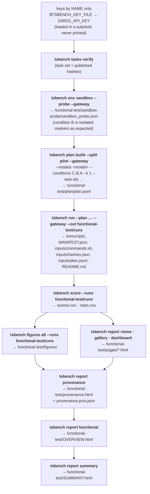

# Functional test of this repository

Purpose: show that the whole pipeline of tsbench works end to end with a real model, without spending Anthropic
credit. One open model served through the gateway endpoint of `tsbench --gateway` answers a few pilot tasks in all
three conditions; the results are scored, drawn and rendered. It tests the *machinery*, not the models: its numbers
are not benchmark results.



One command runs all of it (each step's command line, exit code and log go to `functional-test/steps.jsonl` and
`functional-test/logs/`):

```bash
tools/functional_test.sh --model qwen3.5-397b-a17b          # gateway; key GWDG_API_KEY by name from the key file
```

```bash
tools/functional_test.sh --fake                              # the same steps with the fake claude: no network, no key
```

```bash
tools/functional_test.sh --fake --no-trace                   # the same, without the trace and the provenance page
```

Default tasks: `P-closed_form-01, P-tetrahedral-01, P-crossover-01` (pilot split; `--tasks` changes them), k = 1, run
order C, B, A. `functional-test/` is git-ignored, and so are its trace folders and provenance files.

The key file is `$TSBENCH_KEY_FILE`, by default `~/.config/tsbench/env`: a shell file outside the repository that sets
`GWDG_API_KEY`. In the gateway mode the script loads it in a subshell for each step and never prints or writes its
values. The fake mode does not read it.

How to read the result: open `functional-test/SUMMARY.html`. It lists what was tested, each step with pass or fail,
the runs of `scores.csv` with a category (the reason for a run that is not evaluable; `max_turns`, `budget`,
`no_result`, `api_error` or `unparseable` for a stop or a format failure; else `wrong` or `correct`), and links to the
stored inputs (`runs/inputs/commands.sh` re-runs everything) and to every output. When the provenance page and the
overview exist, the summary links them.

## Overview page

`functional-test/OVERVIEW.html` puts the test on one page: fact tiles (steps passed, hash chain, traced processes,
files read and written, wall time, runs correct), the steps on a time line, per step the files it read from an
earlier step or from outside and the files it wrote, which step read what another wrote, and the runs as a task x
condition grid. The figures are drawn with the Figura bundle; each has a table for readers without
JavaScript. The script renders the page after the provenance page when the test is traced:

```bash
uv run tsbench report functional --steps functional-test/steps.jsonl --out functional-test/OVERVIEW.html
```

## Provenance page

`functional-test/provenance.html` shows where each output came from, and which files each process read and wrote. The
script renders it after the steps and before the summary:

```bash
uv run tsbench report provenance --steps functional-test/steps.jsonl --trace functional-test/trace --out functional-test/provenance.html
```

The page works without JavaScript and loads nothing from the network. The command exits with 0 when the hash chain is
intact and with 1 when it is broken. It writes the page and the PROV-JSON file either way.

Read the page from the top:

1. **Verdict.** The first line says `Hash chain intact` or `Hash chain broken`. When the chain is broken, the page
   lists the paths that break it.
2. **Steps.** One section per step, in run order. Each section has the id `step-<name>`, for example `step-run`, and
   starts with the step's command. A step with no trace folder says `no trace`.
3. **Processes.** Under each step, one block per traced tsbench process, with its command line.
4. **Call tree.** Each process has a collapsible call tree. Open a function to see the tsbench functions it called,
   and how often. Recursion does not hang the page.
5. **Inputs and outputs.** Each process lists the files it read (inputs) and the files it wrote or renamed (outputs).
   Each entry shows the first 12 hex characters of its sha256. The PROV-JSON file has the full value.
6. **Links.** An input that an earlier step wrote links to that output, so you can see which step made the file you
   read.

Paths are shown relative to the folder of the page. The home folder appears as `~`. The page never shows environment
values or file contents.

How the hash chain works. For each input, the producer is the earlier process that wrote the file last, before the
reader started. If the producer's sha256 at the end differs from the reader's sha256 at the read, the chain is broken:
the file changed between the write and the read. An input that no traced process wrote, such as a repository file, has
no producer and is not checked. A temporary file that was renamed away has no output hash and is left out of the
outputs.

The PROV-JSON file holds the same graph in the W3C PROV-JSON format, with the prefix `tsbench`. Entities are file
versions (a path and its sha256). Activities are the traced processes. `used` and `wasGeneratedBy` link them. A file
version that one process wrote and another read is one entity.

## What is traced

- `functional-test/trace/<step>/<unique>-<pid>.trace.json`: one record per traced tsbench process. The steps are
  `tasks-verify`, `sandbox-probe`, `plan-build`, `run`, `score`, `figures`, `report-views`, `report-gallery` and
  `report-dashboard`.
- `functional-test/provenance.html`: the page described above.
- `functional-test/provenance.prov.json`: the PROV-JSON file.
- `functional-test/OVERVIEW.html`: the overview page.

In a `--fake` run the fake claude is traced too. With a real model, the claude processes are not traced. They show only
as subprocess events in the tsbench records. With `--no-trace` there is no trace folder, no provenance file, no overview,
and the summary links neither page.

What the record holds, and what it does not, is in [methods.md](methods.md#44-provenance). In short: the record covers
Python-level I/O and the tsbench call tree only, and it has no data flow inside functions. Home folders are shown as
`~`. A key file or a `.env` file is listed without a hash. The page shows a chain of
hashes. It does not show that a result is correct.
